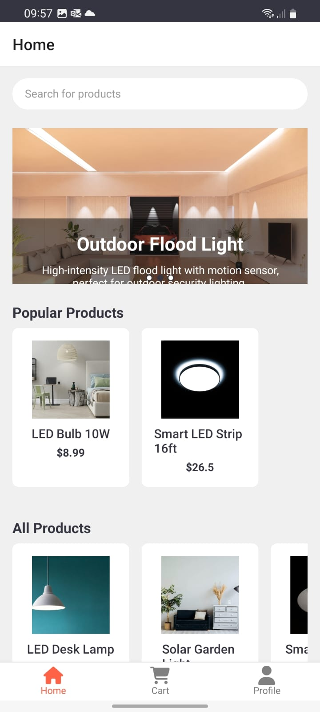
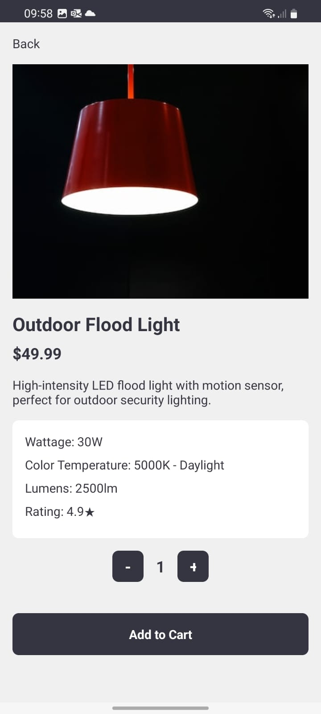
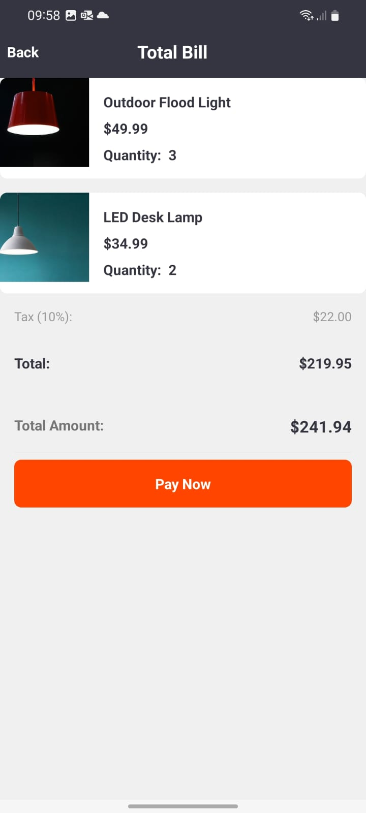
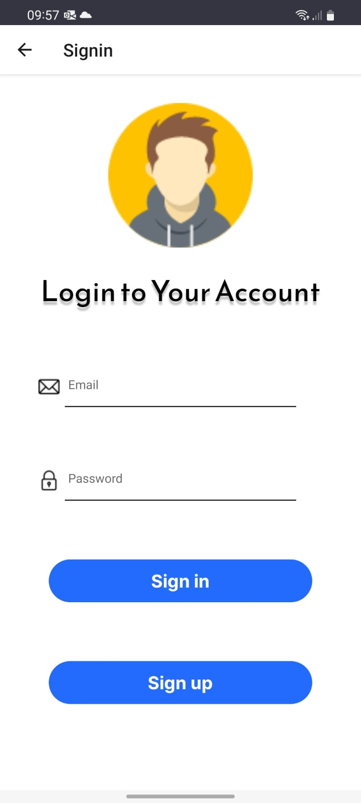
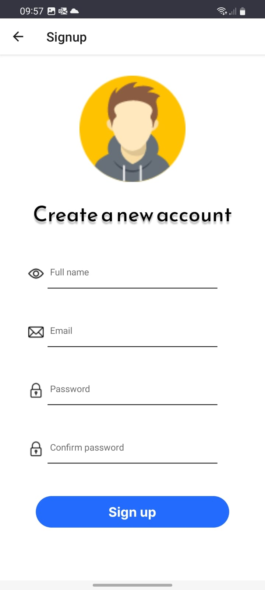
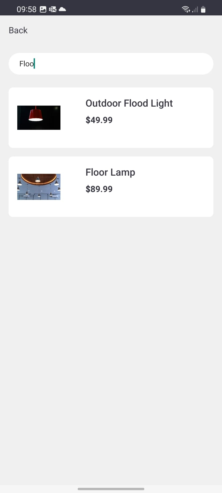
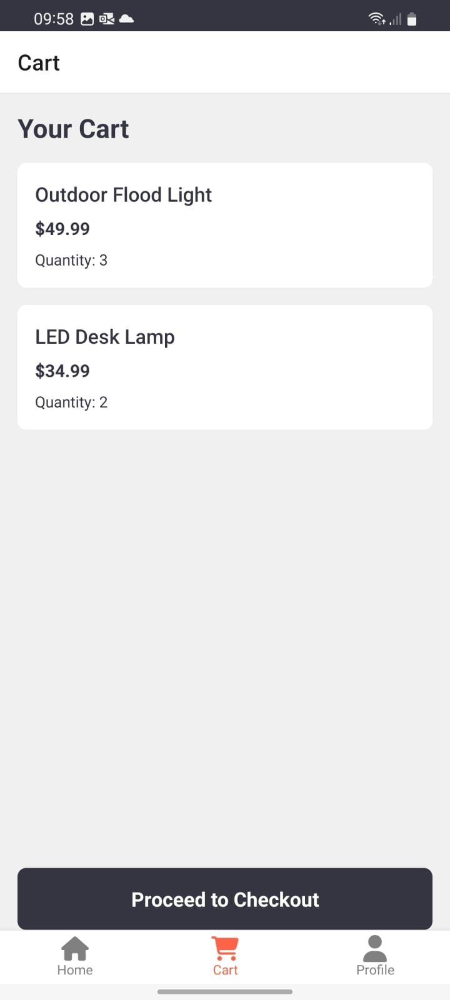
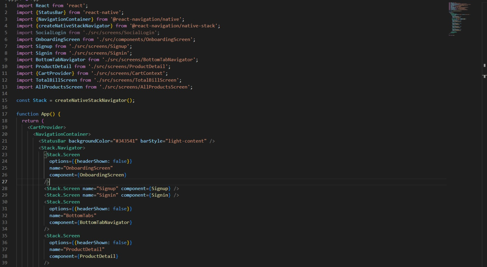
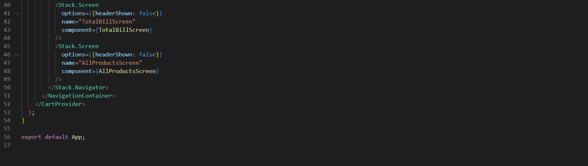
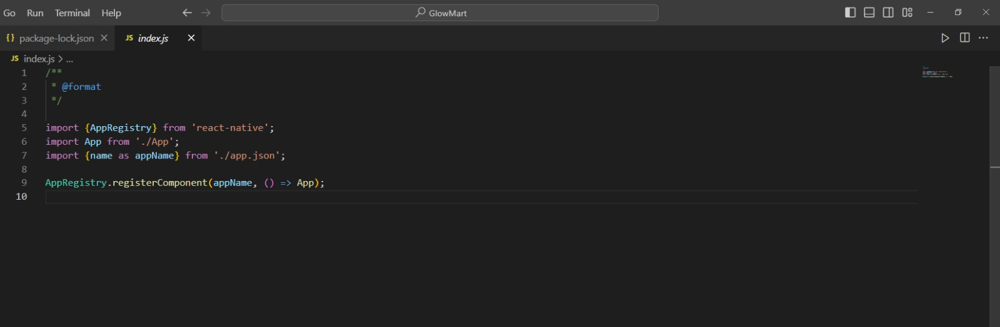

<h1 align="center">GlowMart</h1>

<p align="center">
  A mobile shopping app for lighting products, built for <b>Saint Mediterranean Lux</b>.
</p>

<p align="center">
  
  
  
  
  
</p>

<p align="center">
  
  
  
</p>

## About

GlowMart lets customers browse a lighting catalog, search for products, view specs, build a cart, and review a full bill with tax before paying. It was built as the team project for **CSC 3323 (Section 02), Spring 2023**, supervised by Dr. Bouchaib Falah.

**Team:** Maissae Azaroual, Adnane Ahroum, Selma Habhouba

## App Walkthrough

### 1. Account access
New users go through an onboarding flow, then sign up or sign in with email and password through Firebase Authentication.

<p align="center">
  
  &nbsp;&nbsp;
  
</p>

### 2. Browse and search
The home screen shows a featured product carousel, a Popular Products row, and the full catalog. The search bar filters products by name as you type.

<p align="center">
  
  &nbsp;&nbsp;
  
</p>

### 3. Product details
Each product page shows the price, description, and technical specs (wattage, color temperature, lumens, rating), with a quantity selector and an Add to Cart button.

<p align="center">
  
</p>

### 4. Cart and checkout
The cart lists every item with its quantity. The Total Bill screen breaks down the subtotal, adds 10% tax, and shows the final amount before payment.

<p align="center">
  
  &nbsp;&nbsp;
  
</p>

## Features

| Feature | Details |
|---|---|
| Onboarding | Swipeable intro screens (`react-native-onboarding-swiper`) |
| Authentication | Email sign up and sign in with Firebase Auth, plus a profile screen |
| Featured carousel | Auto sliding banner of highlighted products (`react-native-swiper`) |
| Live search | Filters the catalog by product name as you type |
| Product specs | Wattage, color temperature, lumens, and rating per product |
| Cart | Shared cart state through React Context (`CartContext.js`) |
| Billing | Itemized bill with 10% tax and total amount |
| Navigation | Bottom tabs (Home, Cart, Profile) plus stack navigation |

## Tech Stack

- **React Native 0.71** and **React 18** for the cross platform app
- **React Navigation** (native stack and bottom tabs)
- **Firebase 9** for authentication
- **Font Awesome** and **react-native-svg** for icons
- Custom fonts: Inter, Outfit, Reem Kufi Ink, Ubuntu

## Getting Started

### Requirements
- Node.js 18 (see `.node-version`)
- npm or Yarn
- Android Studio (Android) or Xcode with CocoaPods (iOS, macOS only)

### Setup

```bash
git clone https://github.com/Adnane-Ahroum/GlowMart.git
cd GlowMart
npm install

# iOS only
cd ios && pod install && cd ..
```

Add your Firebase project credentials to `firebaseConfig.js`, then run:

```bash
npm run android   # or: npm run ios
```

A prebuilt Android APK is available at `android/app/release/app-release.apk`.

## Project Structure

```
GlowMart/
├── App.js                  # Root stack navigator (onboarding, auth, tabs)
├── firebaseConfig.js       # Firebase setup
├── src/
│   ├── assets/images/      # Product and UI images
│   ├── components/         # Reusable UI (buttons, inputs, onboarding)
│   └── screens/            # Home, ProductDetail, Cart, TotalBill, Login, Signup, Profile
├── android/                # Android native project
├── ios/                    # iOS native project
└── docs/screenshots/       # README images
```

<details>
<summary><b>Code screenshots</b></summary>
<br>

**App.js**




**index.js**


</details>

## Project Documents

- [Milestone 1](MILESTONE1.pdf)
- [Milestone 2](Milestone%202%20software.pdf)
- [Milestone 3](milestone%203.pdf)
